# SofaGym

Software toolkit to easily create an [Gym](https://github.com/openai/gym) environment out of any [SOFA](https://github.com/sofa-framework/sofa) scene.

The toolkit provides an API based on the standard Gym API, allowing to train classical Reinforcement Learning algorithms. 

The toolkit also comprises example scenes based on the SoftRobots plugin for SOFA to illustrate how to include SOFA simulations and train learning algorithms on them.

## Installation

### 1) SOFA and its plugins

SofaGym needs a [SOFA build](https://www.sofa-framework.org/community/doc/getting-started/build/linux/) with the
[SofaPython3](https://github.com/sofa-framework/SofaPython3) plugin. It is tested with SOFA 26 (the master branch,
version 26.12.99); SOFA v23.06 is no longer supported (it is the reference of the behaviour regression tests, see
`tests/regression/README.md`).

The example environments also need these plugins, built [in-tree](https://www.sofa-framework.org/community/doc/plugins/build-a-plugin-from-sources/#in-tree-build):

| Plugin | Used by |
|---|---|
| [STLIB](https://github.com/SofaDefrost/STLIB) (provides the `splib3` and `stlib3` Python modules) | most scenes |
| [SoftRobots](https://github.com/SofaDefrost/SoftRobots) | the soft robots (Trunk, Diamond, Gripper, Maze, ...) |
| [SoftRobots.Inverse](https://github.com/SofaDefrost/SoftRobots.Inverse) | DiamondSceneInverse |
| [BeamAdapter](https://github.com/sofa-framework/BeamAdapter) | ConcentricTubeRobot, CatheterBeam |
| [Cosserat](https://github.com/SofaDefrost/plugin.Cosserat) | CartStem, CartStemContact, CatchTheObject |
| [ModelOrderReduction](https://github.com/SofaDefrost/ModelOrderReduction) | MultiGaitRobot |

### 2) Python environment

Tested with Python 3.12, in a conda environment. SofaGym works with [Gymnasium](https://gymnasium.farama.org)
(>= 1.0), [Stable Baselines3](https://github.com/DLR-RM/stable-baselines3) (>= 2.0) and
[rl-agents](https://github.com/eleurent/rl-agents) (tree search planners).

```bash
pip install -r requirements.txt   # SofaGym, training, experiments, planning and tests
pip install -e .                  # SofaGym itself
```

### 3) Environment variables

SOFA's Python modules must be found: set `SOFA_ROOT` to the SOFA build and add its Python packages to `PYTHONPATH`.
The scripts of `experiments/` read them from a `.env` file at the root of the repository (not versioned):

```bash
SOFA_ROOT=/path/to/sofa/build
PYTHONPATH=/path/to/sofa/build/lib/python3/site-packages
```

```bash
set -a; . ./.env; set +a                       # in each shell
python test_env.py -e cartstem-v0 -ep 1 -s 10  # check the installation
pytest                                         # the tests (in parallel, see pytest.ini)
```

Rendering (`render_mode="rgb_array"`, the videos) needs a display.


## Quick Start

```bash
export SOFA_ROOT=/sofa/build_dir/
export PYTHONPATH=/sofa/build_dir/lib/python3/site-packages:$PYTHONPATH
```
```python
import sofagym.envs  # registers the environments
```

### Test Script

Running any of the available environments without RL training is possible using the script ```test_env.py```.

The script runs the specified environment by taking a random sample action from the environment action space, perfom a simulation step using the chosen action, then get the new state and reward. This cycle is performed for the specified number of steps for each episode or until *done = True* (goal reached or episode terminated). No training happens during these steps or episodes.

```bash
python test_env.py -e trunk-v0 -ep 100 -s 100
```

- -e, --env: environment name from available examples
- -ep, --episodes: number of episodes to run the environment [Optional, default=100]
- -s, --steps: number of steps to run per episode [Optional, default=100]

### Gymnasium Functions

The Gymnasium framework allows to interact with an environment using well-known keywords:
- *step(a)*: allows to perform a simulation step when the agent performs the action *a*. Given the current state of the system *obs_t* and the action *a*, the environment then changes to a new state *obs_{t+1}* and the agent receives the reward *rew*. If the goal is reached, the *terminated* flag changes to *True*; after the *timer_limit* steps of the environment, the *truncated* flag changes to *True*.
- *reset*: resets the environment, optionally with a seed.
- *render*: gives a visual representation of *obs_t* (create the environment with `render_mode="rgb_array"`).

The use of this interface allows intuitive interaction with any environment, and this is what SofaGym allows when the environment is a Sofa scene. For more information on Gymnasium, check the official [documentation page](https://gymnasium.farama.org).

### Simple Example Script

```python
import gymnasium as gym
import sofagym.envs

env = gym.make('trunk-v0', render_mode="rgb_array")
observation, info = env.reset(seed=42)

done = False
while not done:
    action = env.action_space.sample()  # this is where you would insert your policy
    observation, reward, terminated, truncated, info = env.step(action)
    done = terminated or truncated
    image = env.render()

env.close()
```

The classic running of an episode is therefore:
- *env = gym.make(env_name)*: creation of the environment using the Gymnasium interface.
- *env.reset()*: Initialization of the environment at its starting point.
- *action = model(obs_t)* and *env.step(action)*: execution of actions in the environment.
- *env.close()*: end of simulation and destruction of the environment.

### Training

RL algorithms can be used with SofaGym to train RL agents for the provided environments to perform specific tasks. The training in SofaGym is done with [Stable Baselines3](https://github.com/DLR-RM/stable-baselines3).

To train a model for one of the registered environments of SofaGym, the ```rl.py``` script can be used:

```bash
python rl.py -e trunk-v0 -a PPO
```

Command line arguments can be used to change the training parameters:
- -e, --environment: environment name from available examples (For list of available examples, see [Environments](https://github.com/SofaDefrost/SofaGym#the-environments))
- -a, --algorithm: RL algorithm name: A2C, DDPG, DQN, PPO, SAC, TD3
- -ne, --env_num: number of environments trained in parallel [Optional, default=1]
- -s, --seed: seed used to initialize the environment [Optional, default=0]
- -st, --total_timesteps: number of training steps [Optional, default=None]
- -mst, --max_steps: maximum number of steps to perform per episode [Optional, default=None]
- -tr, --train: option to choose between training a new model, continue training of an available model, or no training [Optional, default='new']
- -te, --te: option to test the trained model [Optional, default=False]
- -tn, --num_test: number of tests to run on the trained model [Optional, default=1]
- -md, --model_dir: path to save the model training files

To change the hyperparamters of the RL algorithm and the agent training and evaluation parameters, the YAML [hyperparameters files](agents/hyperparameters) can be used.

## The Environments

|Image|Name|Description|Status|
|----------|:-------------|:-------------|:-------------|
|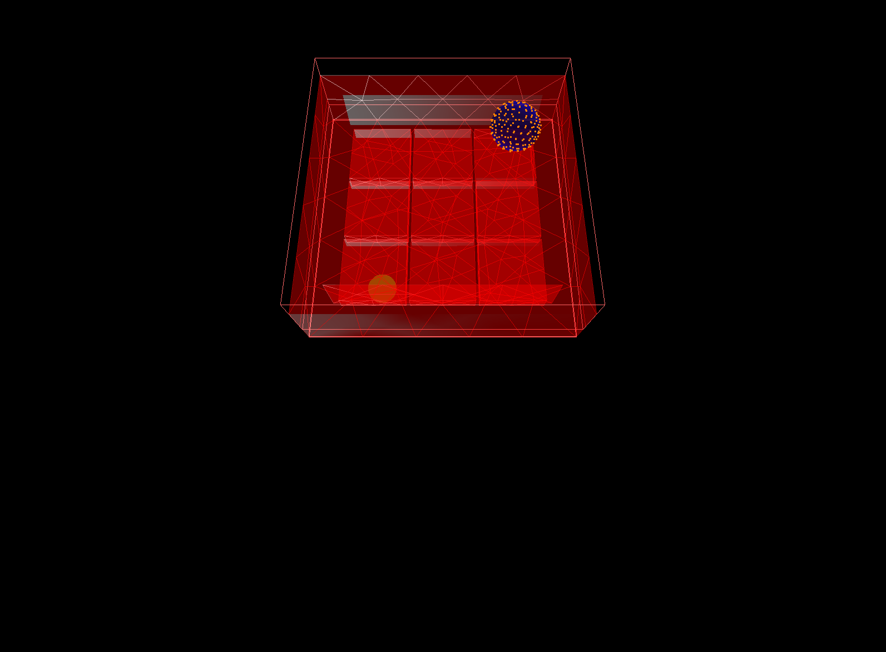|[BubbleMotion](sofagym/envs/BubbleMotion/) bubblemotion-v0| |OK|
|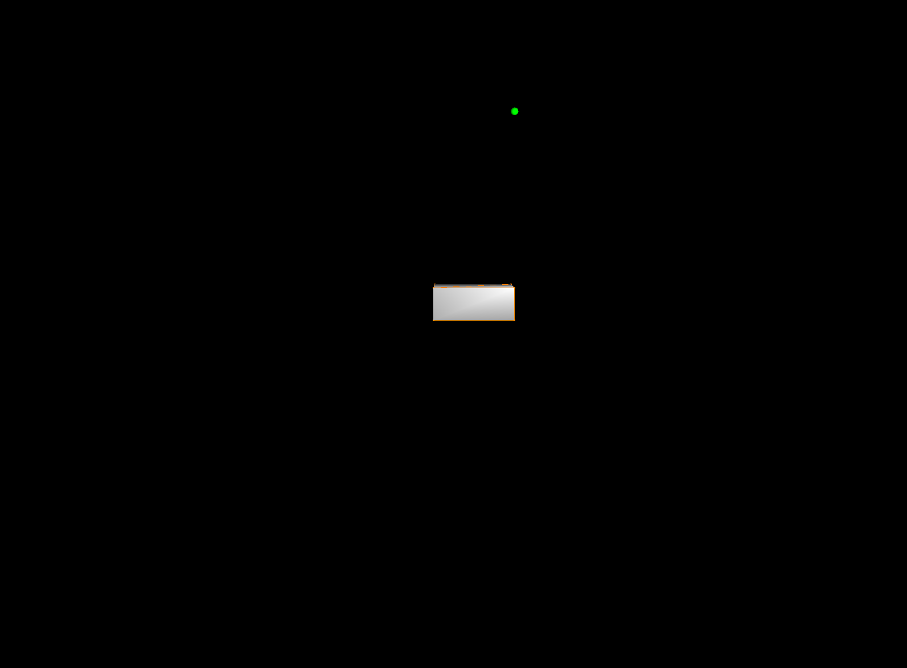|[CartStem](sofagym/envs/CartStem/) cartstem-v0| |OK|
|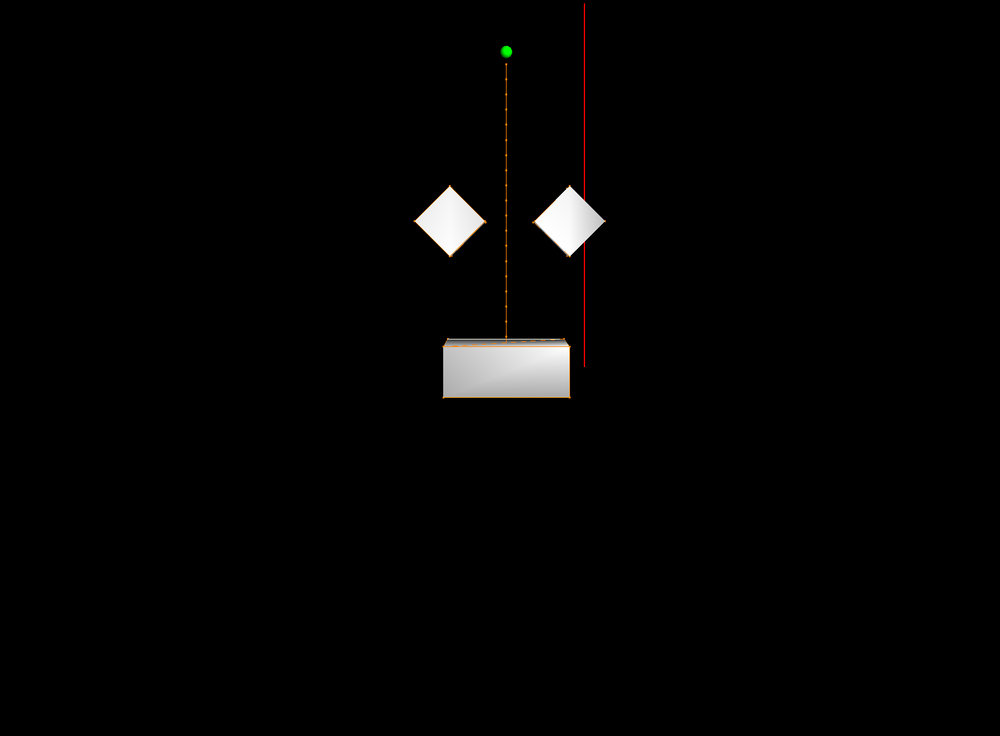|[CartStemContact](sofagym/envs/CartStemContact/) cartstemcontact-v0| |OK|
| |[CatchTheObject](sofagym/envs/CatchTheObject/) catchtheobject-v0| |OK|
|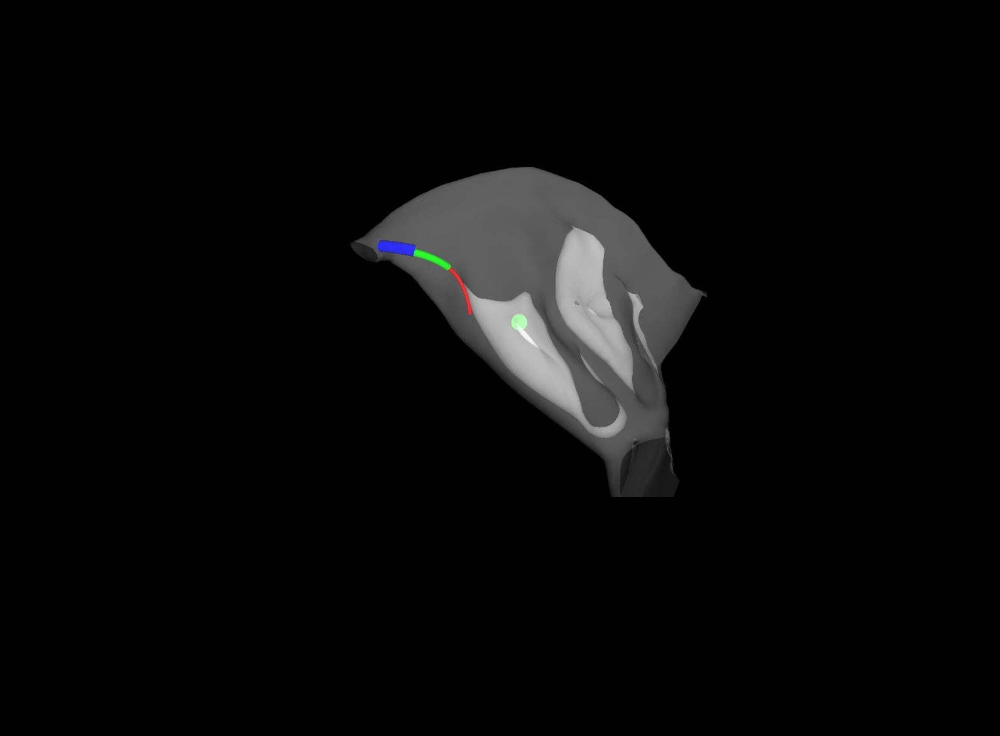|[ConcentricTubeRobot](sofagym/envs/CTR/) concentrictuberobot-v0| |OK|
|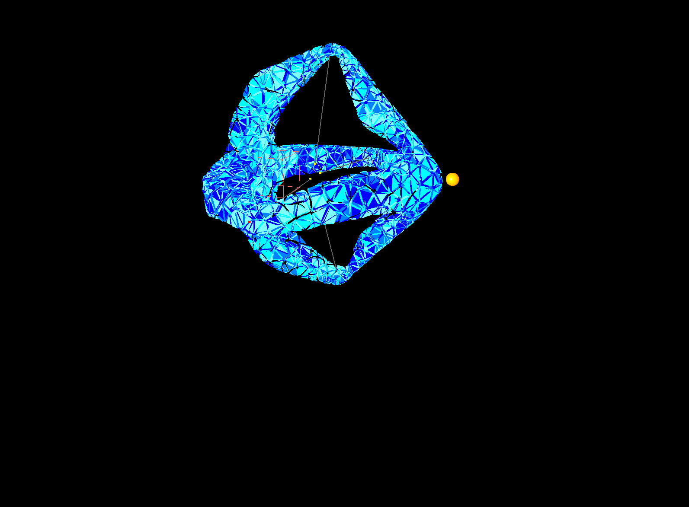|[DiamondRobot](sofagym/envs/Diamond/) diamondrobot-v0| |OK|
|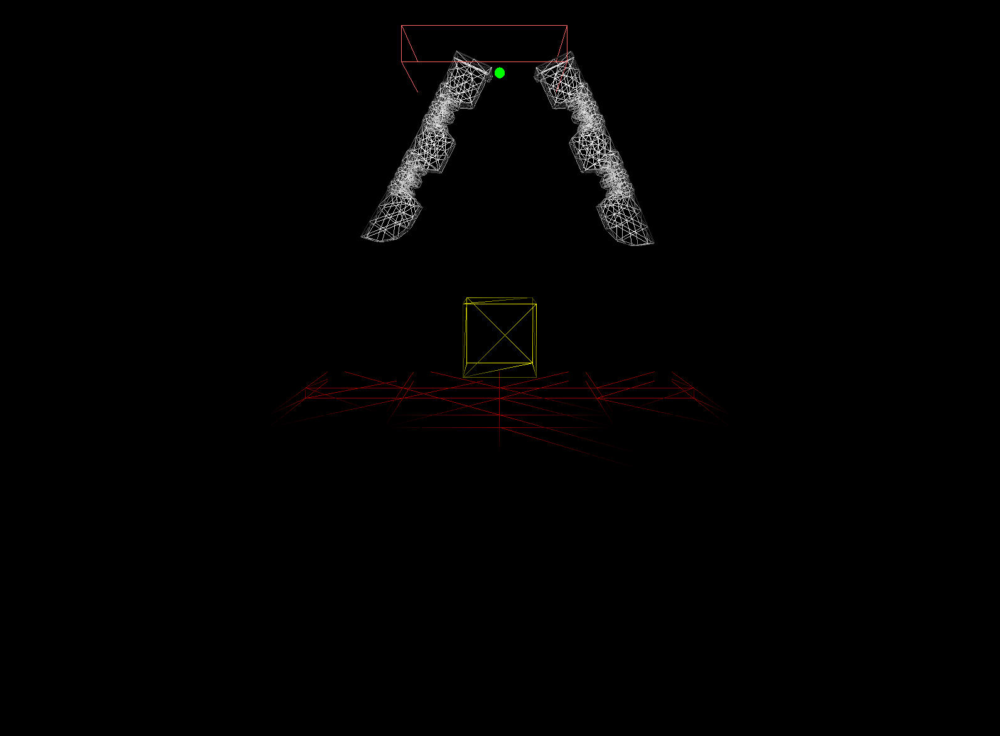|[Gripper](sofagym/envs/Gripper/) gripper-v0| The objective is to grasp a cube and bring it to a certain height.  The closer the cube is to the target, the greater the reward.|OK|
|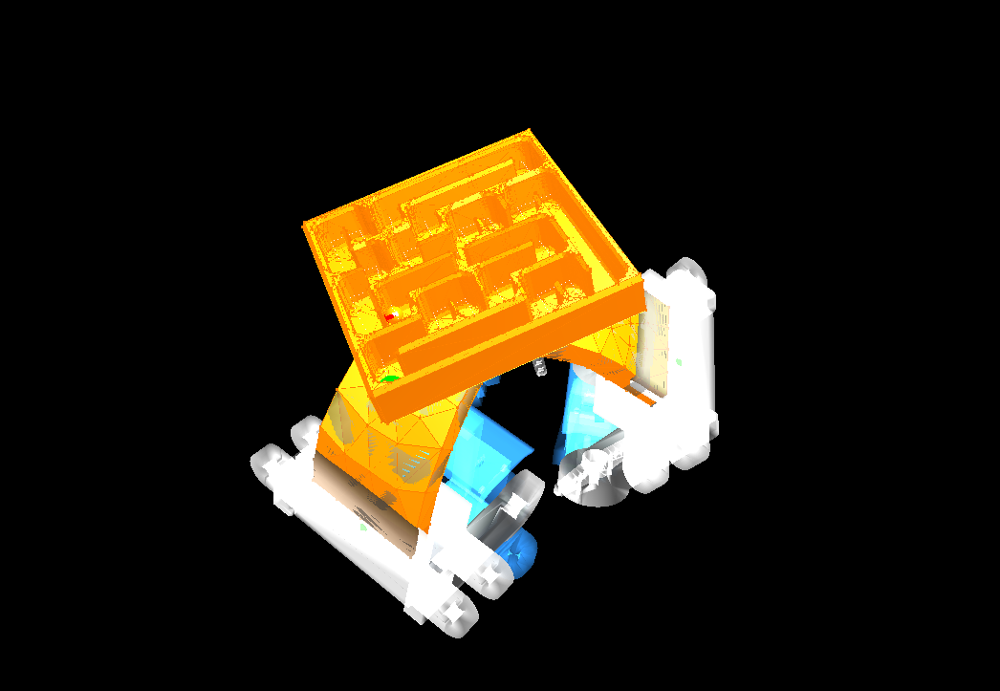|[Maze](sofagym/envs/Maze/) maze-v0| The Maze environment offers one scene  of a ball navigating in a maze. The maze is attached to the tripod robot and the ball is moved by gravity by modifying the maze’s orientation. The tripod is actuated by three servomotors. Similarly to the Trunk Environment, the Maze environment has a dicrete action space of 6 actions, moving  each  servomotor  by  one  increment,  and could easily be extended to be continuous.|OK|
|  |[MultiGait Robot](sofagym/envs/MultiGaitRobot/) multigaitrobot-v0| The multigait Softrobot has  one  scene. The goal is to move the robot forward in the *x* direction with the highest speed. env = gym.make("multigaitrobot-v0")|[ERROR]   [SofaRuntime] ValueError: Object type MechanicalMatrixMapperMOR<Vec1d,Vec1d> was not created The object is not in the factory. Need MOR plugin ?|
|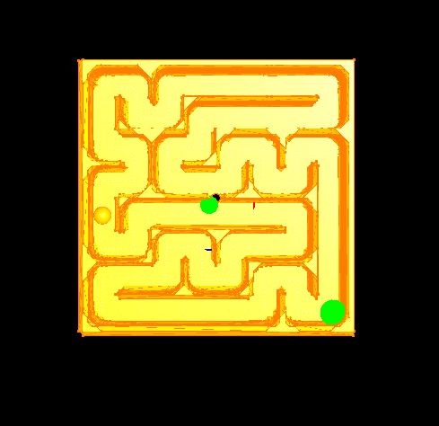|[SimpleMaze](sofagym/envs/SimpleMaze/) simple_maze-v0| |OK| 
|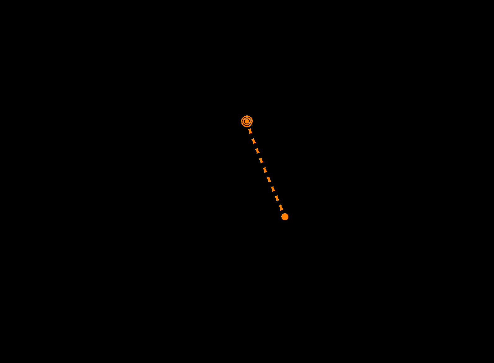|[StemPendulum](sofagym/envs/StemPendulum/) stempendulum-v0| |OK|
|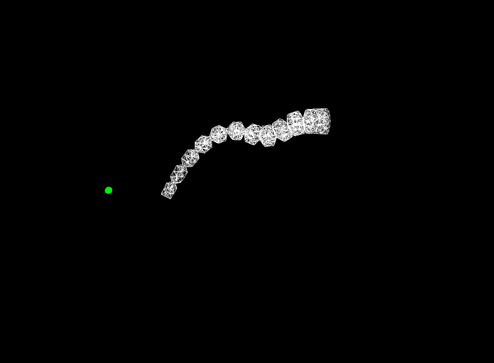|[Trunk](sofagym/envs/Trunk/) trunk-v0| The Trunk environment offers two scenarios.  Both are based on the trunk robot.  The first is to bring the trunk’s tip to a certain position. The second scenario is to manipulate a cup using the trunk to get the cup’s center of gravity in a predefined position. The  Trunk  is  controlled  by  eight  cables  that can be contracted or extended by one unit.  There are therefore 16 possible actions. The action space presented here is discrete but could easily be ex-tended to become continuous.|OK |
|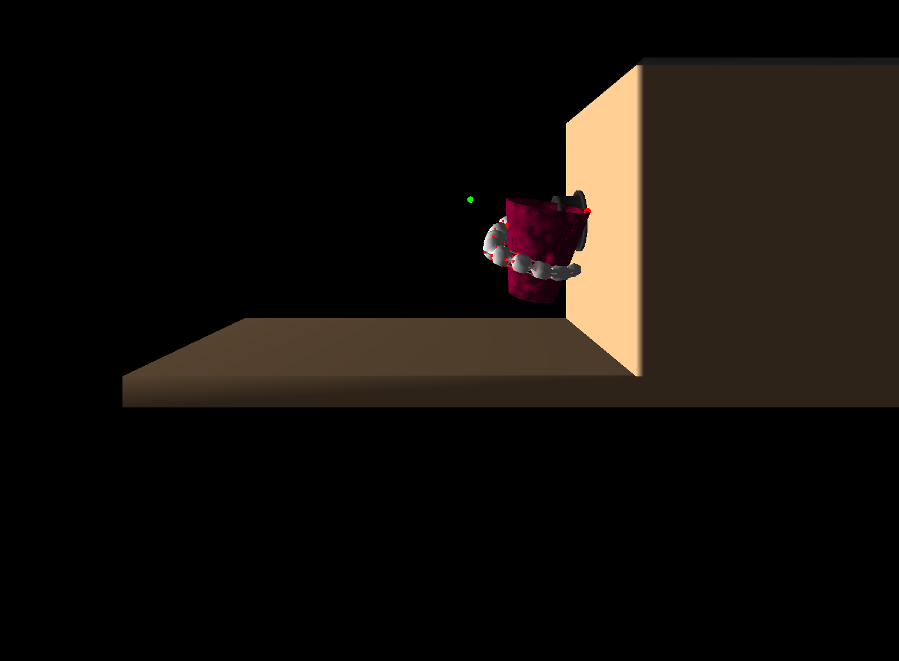|[TrunkCup](sofagym/envs/TrunkCup/) trunkcup-v0| |OK|
|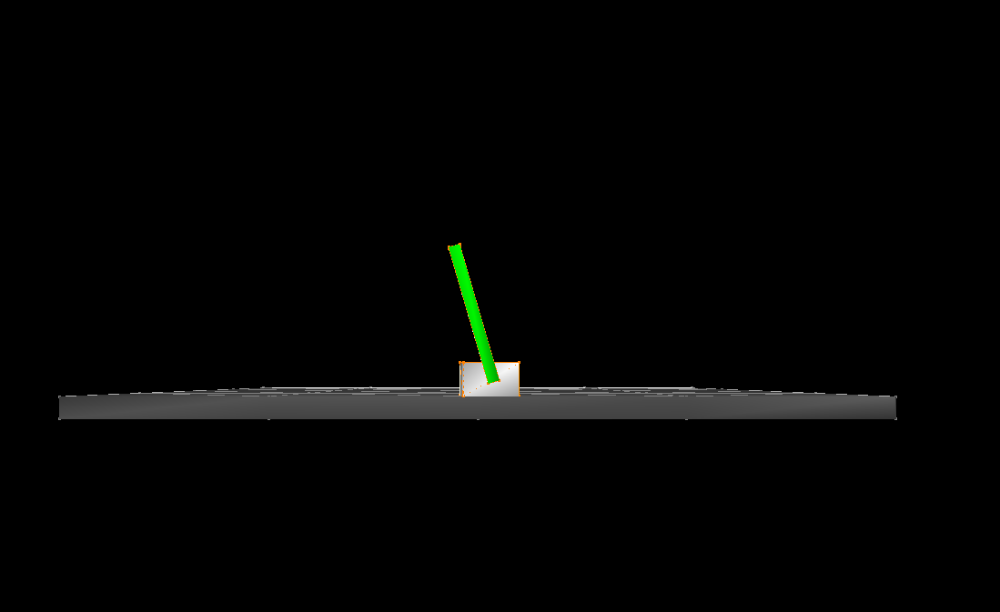|[CartPole](sofagym/envs/CartPole/) cartpole-v0| The CartPole environment is based on the [same environment](https://gymnasium.farama.org/environments/classic_control/cart_pole/) found in Gymnasium. It is based on the classical control problem where the goal is to balance the pole upright by moving the cart left and right. The cartstem example is the soft analogue of this environment.|OK|


### Units

Each scene module declares the unit system its SOFA values are expressed in, with SofaPython3's `Sofa.Units`:

```python
UNITS = MechanicalUnitSystem(time=s, length=cm, mass=kg)
```

`tests/test_units.py` checks that each scene's gravity is either off or 9.81 m/s² in its declared units.

| Unit system | Scenes |
|---|---|
| s, cm, kg | BubbleMotion, CartPole, CartStem, CartStemContact, CatchTheObject, SimpleMaze, StemPendulum |
| s, mm, kg | Diamond, DiamondSceneInverse, Gripper, Maze, MultiGaitRobot, Trunk, TrunkCup, CTR and CatheterBeam (gravity off) |

Diamond, DiamondSceneInverse and Gripper used a gravity of 9.81 (m/s²) with mm geometry, and TrunkCup 9180: they use 9810 mm/s² since the SOFA 26 update (towards the fixed base, -z, for the Diamond). CTR used 9.81 too: it has no gravity, as CatheterBeam.

### Keyboard Control

Some scenes can be driven by hand from the SOFA GUI, through a keyboard controller defined in the environment's `Controller.py` (`Controllers.py` for the Gripper). The controller is added when the scene config has `"keyboard_controller": True`. This is the case in the scene's default config, which runSofa uses, so opening the scene is enough:

```bash
$SOFA_ROOT/bin/runSofa -l SofaPython3 sofagym/envs/CartStem/CartStemScene.py
```

Key presses only reach the scene while a modifier is held: **Ctrl+Shift** in the default SofaGLFW interface (**Ctrl** in the Qt interface).

| Environment | Scene file | Keys |
|---|---|---|
| BubbleMotion | `BubbleMotionScene.py` | ←/→ select the cavity, ↑/↓ increase/decrease its pressure |
| CartStem | `CartStemScene.py` | ←/→ push the cart left/right |
| CartStemContact | `CartStemContactScene.py` | ←/→ push the cart left/right |
| CatchTheObject | `CatchTheObjectScene.py` | ←/→ decrease/increase the pressure |
| StemPendulum | `StemPendulumScene.py` | ←/→ apply torque in either direction |
| CTR | `CTRScene.py` | 0/1/2 select the tube, ↑/↓ push/pull it, →/← spin it, D drop the tool (built in, see below) |
| CatheterBeam | `CatheterBeamScene.py` | 0/1/2 select the catheter, guide or coils, ↑/↓ push/pull it, →/← spin it (built in, see below) |
| Gripper | `GripperScene.py` | ←/→ and ↑/↓ move the fingers horizontally, U/D move them up/down, A/C, 5/6 and 7/8 rotate them around y, x and z, 1/2 pull/release the cables |

The environments set `"keyboard_controller": False` in their `DEFAULT_CONFIG`, so no controller is added in batch mode (training, tests). Pass `config={"keyboard_controller": True}` to the environment to add it anyway.

CTR and CatheterBeam do not use a Python controller: their keys are handled by BeamAdapter's `InterventionalRadiologyController` itself (`listening=True` in the scenes). It is always active in the GUI and is not affected by `keyboard_controller`, and it is not covered by the keyboard tests since SofaPython3 cannot send key events to C++ components.

### Adding New Environment

It is possible to define new environments using SofaGym. Already existing SOFA scenes and newly created scenes can be modified to be used in SofaGym. A tutorial on how to create a new environment is available at [CartPole Tutorial](examples/tutorials/CartPole/CartPole_Tutorial.md).

For this purpose different elements have to be created:
- *NameEnv*: inherits from *AbstractEnv*. It allows to give the specificity of the environment like the action domain (discrete or continuous) and the configuration elements.
- *NameScene*: allows to create the Sofa scene. It must have the classic createScene function and return a *root*. To improve performance it is possible to separate the visual and computational aspects of the scene using the *mode* parameter (*'visu'* or *'simu'*). It allows you to choose the elements in the viewer-related scene or in the client-related scene. We also integrate two Sofa.Core.Controller (rewardShaper and goalSetter) that allow to integrate goal and reward in the scene.
- *NameToolbox*: allows to customize the environment. It defines the functions to retrieve the reward and the state of the environment as well as the command to apply to the system (link between the Gym action and the Sofa command). Note that we can define the Sofa.Core.Controller here. 

These different elements make it possible to create and personalise the task to be performed. See examples of environments for implementation.


## The Tools

### Server/Worker Architecture

The major difficulty encountered in this work is the fact that it is not possible to copy the *root* from a Sofa simulation. This implies that when two sequences of actions *A_1 = [a_1, ..., a_n, new_action_1]* and *A_2 = [a_1, ..., a_n, new_action_2]* have to be tried, it is necessary to start again from the beginning each time and simulate again *[a_1, ..., a_n]*. This leads to a huge loss of performance. To solve this problem a server/worker architecture is set up.

A server takes care of distributing the calculations between several clients. Each client *i* is associated with an action sequence *A_i = [a_{i1}, ...., a_{in}]*. Given an action sequence *A = [a_{1}, ...., a_{n}]* and a new action *a*, the server looks for the client with the action sequence *A_i*. This client forks and the child executes the new action *a*. The father and son are referenced to the server as two separate clients and the action sequence *[a_{1}, ...., a_{n}]* and *[a_{1}, ...., a_{n}, a]* can be accessed.

A cleaning system is used to close clients that are no longer used. This makes it possible to avoid having an exponential number of open clients.

When it is not necessary to have access to the different states of the environment, i.e. when the actions are used sequentially, only one client is open and performs the calculations sequentially.

### Vectorized Environment


Simulation training can be time consuming. It is therefore necessary to be able to parallelise the calculations. Since the actions are chosen sequentially, it is not possible to parallelise the calculations for one environment. The result depends on the previous result. However, it is possible to parallelise on several environments, meaning to run several simulations in parallel. This is done with the baseline of OpenAI: SubprocVecEnv.


### Separation between Visualisation and Computations

SofaGym separates calculations and visualisation. In order to achieve this, two scenes must be created: a scene *A* with all visual elements and a scene *B* with calculation elements (solvers, ...). Scene *A* is used in a viewer and scene *B* in the clients. Once the calculations have been performed in scene *B*, the positions of the points are given to the viewer which updates scene *A*.

## Results

In this section we demonstrate some use cases of the environments available in SofaGym, namely Reinforcement Learning, Imitation Learning, planning using Monte Carlo Tree Search and shape optimisation using Bayesian Optimization.

### Reinforcement Learning: Learning to grasp different objects with GripperEnv
### Imitation Learning: Learning to imitate an inverse controller with TrunkEnv
### Monte Carlo Tree Search: solving MazeEnv with planning

In planning mode, the server architecture keeps a simulation (a forked SOFA process) per sequence of actions, so that a planner can simulate any branch of its tree. The tree search agents of [rl-agents](https://github.com/eleurent/rl-agents) work with it:

```python
import gymnasium as gym
import sofagym.envs
from rl_agents.agents.tree_search.mcts import MCTSAgent

env = gym.make("maze-v0", config={"planning": True}, use_server=True)
agent = MCTSAgent(env, {"budget": 50, "gamma": 0.9})
observation, info = env.reset(seed=0)
done = False
while not done:
    action = agent.act(observation)
    observation, reward, terminated, truncated, info = env.step(action)
    env.unwrapped.clean()  # close the simulations of the branches the agent left
    done = terminated or truncated
env.close()
```

A planner can also branch by hand: set `env.unwrapped.past_actions` to the actions leading to a state, then `step` from it.


## Reproducing the paper

`experiments/` reproduces the experiments of the SofaGym paper (Ménager, Schegg et al., Soft Robotics 2023): the RL
baseline (PPO and SAC on CartStem, CartStemContact and CatchTheObject, 6 seeds, section 5.1) and the planning with OPD
(Diamond, ConcentricTubeRobot, Trunk, SimpleMaze, sections 5.3 and 5.4). The runs take days; the script is
resumable (rerun it to continue, a run whose code changed restarts) and runs them in parallel:

```bash
set -a; . ./.env; set +a
experiments/reproduce.sh                                  # everything
SEEDS="0" ENVS="cartstem-v0" ALGOS=PPO experiments/reproduce.sh   # a subset
```

To run it in the background with a memory cap, see `experiments/README.md` (systemd unit, `CPUS`, ~2.3 GB per
process). The results go to `experiments/results/` (not versioned): the models and test rewards of each run, the
figures (`benchmark/<env>_rewards.png`), the planning summary (`planning/summary.md`) and, with a display, videos of
the best agents and of the plans (`videos/`, with the goal in green and the effector in red).

Results on SOFA 26 (details, the choices the paper does not give and the differences in `experiments/README.md`):

| Experiment | Paper | Here |
|---|---|---|
| CartStem, PPO (final test reward) | ~70-75 | 55.6 ± 9.1 (the stem bends more on SOFA 26) |
| CartStemContact, SAC / PPO | ~-5, PPO below | -2.6 ± 0.2 / -8.0 ± 1.6 |
| CatchTheObject, PPO / SAC | ~-3 / ~-3 | -3.0 ± 0.1 / -2.7 ± 0.1 |
| Diamond, OPD (10 targets) | 3.13 mm, 38 s | 10/10 reached, 3.72 mm, 29 s |
| ConcentricTubeRobot, OPD (10 targets) | 100% reached | 6/10 reached (budget 192) |
| SimpleMaze, OPD (4 corners) | 4/4 | 4/4 |
| Trunk, OPD (2 goals) | similar to Diamond | 2/2 |

Not reproduced: the AVEC variants of PPO and SAC, the QP side of Diamond's table 1, the gripper (section 5.2) and
the multigait robot (section 5.5).


## Known issues

- **Memory leaks.** Each episode builds a new SOFA scene and part of it is never freed: about 0.25 MB per episode for
  most envs, about 6.5 MB for CatchTheObject (its PPO workers reach 5.5 GB after 40 epochs; the cause is not identified,
  it is not its gmsh script, which runs offline). Long trainings must restart their processes:
  `experiments/benchmark.py` exits after a chunk of epochs and resumes from its checkpoint (50 epochs, 10 for
  CatchTheObject). Count up to ~2.3 GB per process (a PPO run with 4 envs has 5), and cap the memory of long runs (see
  `experiments/README.md`).
- **SOFA's teardown** can crash or hang at the exit of the interpreter for some scenes (also after an exception): the
  scripts and test runners end with `os._exit(0)` after flushing their output.
- **Broken envs.** MultiGaitRobot needs MechanicalMatrixMapperMOR, removed from ModelOrderReduction;
  DiamondSceneInverse was already broken on SOFA v23.06. The tests skip MultiGaitRobot and have no case for
  DiamondSceneInverse.
- **Behaviour changes since SOFA v23.06** (the regression references): CartStem's stem bends over (the expected
  behaviour, the tip weight is above the buckling load), CatheterBeam's catheter has a curved tip. Details and the other
  differences in `tests/regression/README.md`.
- **Writing scenes for SOFA >= v24:**
  - add a `DefaultVisualManagerLoop`: it is no longer created implicitly, and rendering a scene without one crashes
    (segfault in `Sofa.Simulation.initVisual`);
  - BeamAdapter's `InterventionalRadiologyController` overwrites the DOFs with its `startingPos`: give the orientation
    of the instruments there, a rotation of the MechanicalObject (`ry=-90`) is ignored;
  - the data of SoftRobots.Inverse's `SlidingActuator` (e.g. `displacement`) are arrays, one value per actuated index.

## Citing

If you use the project in your work, please consider citing it with:
```bibtex
@misc{SofaGym,
  authors = {Ménager, Etienne and Schegg, Pierre and Duriez, Christian and Marchal, Damien},
  title = {SofaGym: An OpenAI Gym API for SOFASimulations},
  year = {2020},
  publisher = {GitHub},
  journal = {GitHub repository},
}
```
And if you are using for soft robots:
```bibtex
@article{schegg2022sofagym,
  title={SofaGym: An open platform for Reinforcement Learning based on Soft Robot simulations},
  author={Schegg, Pierre and M{\'e}nager, Etienne and Khairallah, Elie and Marchal, Damien and Dequidt, J{\'e}r{\'e}mie and Preux, Philippe and Duriez, Christian},
  journal={Soft Robotics},
  year={2022},
  publisher={Mary Ann Liebert, Inc., publishers 140 Huguenot Street, 3rd Floor New~…}
}
```


## Notes

1. At the moment the available action spaces are: continuous, discrete, tuple and dictionary.
